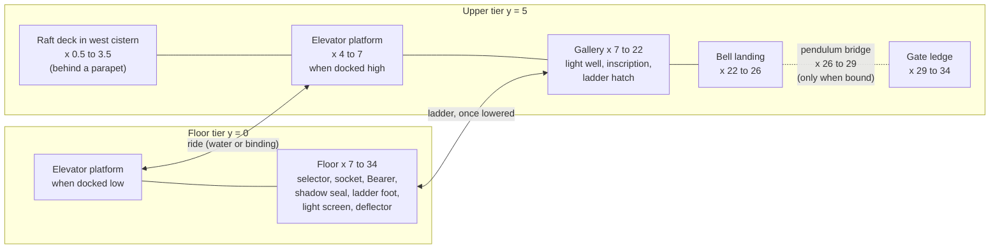

# Borrowed Dawn greybox: physical design

This document explains how the greybox turns the browser prototype's abstract location buttons into a room Ankhu can walk. All numbers live in `Assets/Ankhu/Runtime/Layout/BorrowedDawnLayout.cs`. Units are metres. Ankhu is 1.8 m tall and cannot jump. Vertical travel is only by elevator or ladder.

## Engine defaults (reversible)

| Choice | Default | Why | How to reverse |
|---|---|---|---|
| Editor | Unity 6 LTS | Current long-term support line | Any Unity 6 editor opens the project, nothing pins a patch |
| Render pipeline | URP, Universal 3D renderer | Lets a 3D Ankhu and 2D or 3D scenery share lighting | Swap the renderer asset, gameplay code does not change |
| Gameplay physics | Physics2D in the XY plane | The plane lock comes for free, one axis of motion to test | Replace the controller only |
| Camera | Perspective at 20 degrees, orthographic on F2 | Shows platform depth, both frame the same play area | Serialized enum on the camera rig |
| Input | Input System package | Unity 6 template default, reliable text capture | None needed |
| UI text | uGUI Text with the built-in font | Avoids the TextMeshPro resource import step | Swap later for art |

## Layout

| Element | Position | Driven by snapshot field |
|---|---|---|
| West cistern water and raft with mirror | x 0.5 to 3.5, deck y -3 or 5 | `RaftHigh`, `Mirror` |
| Elevator platform | x 4 to 7, top y 0 or 5 | `ElevatorHigh`, `ElevatorBound` |
| Lift gates (both tiers, x 7) | open only while the platform is docked at that tier | animated platform position, no rule |
| Sun from clerestory through light well to socket | (8.6, 10) to (11.5, 1.4) | `Mirror == Socket` |
| Bearer | pedestal x 14 in the beam, alcove x 9.6 out of it | `BearerAwake` |
| Shadow seal | x 15.6 | `ShadowPresent`, `ShadowBound` |
| Ladder and hatch | x 19.4, y 0 to 5 | `LadderLowered` |
| Light screen | x 21, rises through a floor slot | `LightScreenRaised` |
| Deflector and sun disk | x 32.2, disk at y 9 | `SunReachesGate` |
| Bell | x 24, y 7.6 | `BellRepaired`, `BellEchoing` |
| Pendulum bridge and chain barriers | pivot (26, 5), span 3 m | `BridgeBound` |
| Gate | x 32.2 | `GateOpen` |

## Problem 1: no real descent route

The prototype's "Descend to floor" button teleported Ankhu from the gallery down 5 m. In a walking game that is either a free drop, which also makes falling a valid route everywhere, or a missing route.

**Resolution: a ladder hatch in the gallery.** A counterweighted ladder sits latched under a hatch at x 19 to 19.8. From the floor it is visible but folded out of reach, which reads as a promise. From the gallery Ankhu releases it (`lower_ladder`). Once down it stays down and works both ways. The hatch becomes a one-way platform, so Ankhu can walk across it and press down to climb.

Why it cannot be abused: before it is lowered the gallery is reachable only by riding the elevator, which teaches that water lifts the platform. Lowering it never removes a requirement the puzzle depends on, because the mirror is still only reachable from the high platform while water is west.

## Problem 2: the second elevator trip

In the prototype, after `flow east` gives the elevator physical support and `release elevator` frees the binding, Ankhu is on the floor with the platform at the top. Getting up again meant `flow west` (which drains the support just established and raises the light screen), board, then `flow east` again. The lesson "physical support can replace a binding" was undone on the very next move.

**Resolution: the ladder is the way back up.** With the shadow bound and the Bearer awake, Ankhu says `flow east`, then `release elevator`, then climbs the ladder. The water keeps holding the platform the whole time, so the walkway to the landing stays intact and the sun keeps reaching the gate. The old drain route still works as a slower alternative.

**Load-bearing rule (chosen by Zac):** the elevator binding cannot be released while water is west. Without it, a player could release the elevator straight after taking the mirror and skip the support insight. With it, the only way to free that binding is to give the platform water first, and the ladder is the payoff for understanding that.

## Problem 3: why the mirror needs the elevator

The prototype required "water west and elevator high" to take the mirror, with no physical reason. Here the raft rises in a cistern directly west of the shaft, behind a parapet Ankhu cannot climb. The only place within reach of the raised mirror is the platform docked at the top. Water west lowers an unbound platform, so the binding is physically necessary rather than an arbitrary check.

## Safety and softlock audit

| Risk | Physical answer |
|---|---|
| Walking into the open shaft on either tier | Lift gates are solid unless the platform is docked at that tier |
| Stepping onto the raft and sinking with it | Parapet at y 5.6, mirror taken from the platform |
| Walking into the pendulum gap | Chain barriers at both edges, removed only after the bridge settles horizontal |
| Releasing the bridge while on it or at the gate | Rejected by rules (context carries zone and on-bridge flag) |
| Any fall | Ledge stop in the controller plus a kill plane that returns Ankhu to the last safe ground |
| Moving while the room moves | Platform carries Ankhu, speech and interactions wait for the world to settle |
| Text entry moving Ankhu | Input gate zeroes gameplay input while the bubble is open and for the closing frame |

## Intended solution in the greybox

1. On the floor: `flow west`. The platform comes down and the floor lift gate opens. Step on.
2. `flow east`. Ride up, step into the gallery, read the inscription (E at the wall).
3. Back on the docked platform: `bind elevator`, `flow west`. The raft rises beside you. Take the mirror (E).
4. Walk into the gallery, release the ladder (E at the hatch), climb down.
5. Install the mirror at the socket (E). The Bearer's shadow falls on the seal.
6. `bind shadow`, `wake bearer`. The shadow stays.
7. `flow east`, then `release elevator`. Water now holds the platform.
8. Climb the ladder, walk to the bell landing. `recall bell`, strike it (E), `echo bell`.
9. `bind bridge`, cross, and speak the Name at the gate.

Exact wording of spells is owned by the rules library and the spell grammar thread.
